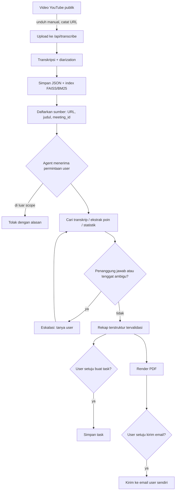
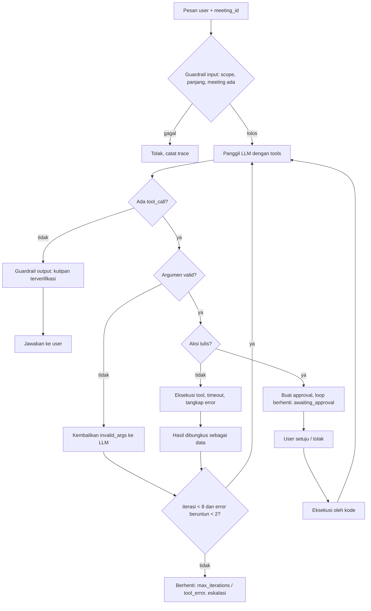

# MeetRecall Agent: Desain Tahap 1

Status: draf, menunggu persetujuan. Belum ada kode agent yang ditulis.
Tanggal: 2026-10-05.

## 1. Temuan repo W6

Sumber dibaca dari folder W6 (read-only). Semua nama di bawah ada di kode; tidak ada yang dikarang.

### 1.1 Pipeline video ke transkrip

| Langkah | Lokasi | Keterangan |
|---|---|---|
| Masuk | `POST /api/transcribe` (`routers/transcribe.py`) | Upload file audio/video (`.mp4 .mkv .mov .avi .mp3 .wav .m4a .webm .ogg .flac`). Tidak ada kode untuk mengunduh dari YouTube; file diunduh manual lalu diupload. |
| Alternatif | `POST /api/transcript/import` | Import transkrip `.txt` (`[hh:mm:ss] Speaker: teks`) atau `.json` tanpa audio (`services/transcript_import.py`). |
| Konversi | `convert_to_wav` (`services/transcription.py`) | ffmpeg ke WAV. |
| Transkripsi + diarization | `TranscriptionOrchestrator`, `PROVIDERS = ("gemini", "groq", "groq_fast", "local")` (AssemblyAI dihapus di W78) | `gemini`: transkripsi dan label speaker dalam satu panggilan, maksimal 30 menit dengan diarization. `groq`: Groq Whisper + pyannote 3.1. `groq_fast`: tanpa diarization (semua "Speaker 1"). `local`: Whisper lokal + pyannote. |
| Segmentasi | `words_to_segments` | Segmen baru bila speaker berganti, jeda lebih dari 1,2 detik, atau lebih dari 45 kata di akhir kalimat. |
| Simpan | `StorageService.save_meeting` (`services/storage.py`) | JSON: `data/meetings.json` (indeks) dan `data/meetings/{meeting_id}.json`. Bukan database. |
| Index | `vector_store.index_segments` | Dipanggil di akhir `_pipeline`, jadi index selalu dibuat sebelum chat. |

Pipeline berjalan sebagai FastAPI background task dan sudah deterministik (tidak ada keputusan LLM di dalamnya). Ini sesuai arsitektur yang diminta; agent cukup membaca hasilnya.

### 1.2 Mekanisme retrieval (termasuk hybrid)

- Chunking (`services/chunking.py`, `CHUNK_VERSION = 2`): segmen berurutan digabung menjadi jendela kira-kira 60 kata (`CHUNK_TARGET_WORDS`), overlap 1 segmen. Setiap baris diberi prefix `Speaker: teks`. Metadata per chunk: `speaker` (gabungan), `start_time`, `end_time`, `segment_count`, `chunk_version`.
- Vector: `paraphrase-multilingual-MiniLM-L12-v2` (384 dimensi, ternormalisasi), FAISS `IndexFlatIP` per meeting, disimpan ke `data/faiss/{id}.index` dan metadata pickle `{id}_chunks.pkl`.
- Full-text: BM25 buatan sendiri (`services/keyword_index.py`, k1 = 1,5, b = 0,75), stopword ID + EN, token kode seperti `mr-218` dipertahankan. Index dibangun ulang di memori dari metadata FAISS, teks yang diindeks adalah `speaker + text`.
- Hybrid (`services/retrieval.py`): fusion `rrf` (default, k = 60) atau `weighted` (min-max, `alpha`). Opsional cross-encoder rerank, abstain bila cosine terbaik di bawah `min_score` (default API 0,40) dan tidak ada chunk yang memuat minimal setengah term query, serta `expand_neighbors`.
- Hasil evaluasi W6 (26 pertanyaan, transkrip sintetis): hybrid Hit@3 0,818, Recall@3 0,705, MRR@3 0,614. Angka ini dari dataset sintetis, belum diukur di meeting YouTube.

Dua perilaku W6 yang perlu dicatat untuk agent:
1. `rag_chain.py` mengirim seluruh transkrip ke prompt untuk pertanyaan "meeting-wide" bila panjangnya di bawah 12.000 karakter. Ini bertentangan dengan aturan W7-W8, jadi agent tidak memakai jalur ini.
2. `key_actions` di W6 adalah regex kata kunci bahasa Inggris (`_ACTION_KEYWORDS`), bukan ekstraksi terstruktur. Tidak bisa dipakai untuk tool action items.

### 1.3 Data yang tersimpan

| Data | Status | Catatan |
|---|---|---|
| Speaker | Ada, tapi generik | Label `Speaker 0`, `Speaker 1`, dst. Nama asli hanya muncul di isi ucapan, kecuali diganti manual lewat `PUT /api/transcript/{id}/speakers`. Konsekuensi: penanggung jawab action item sering ambigu. |
| Timestamp | Ada | `start_time`, `end_time` per segmen (detik) dan per chunk. |
| Topik | Tidak ada | Tidak ada field topik atau agenda di skema. |
| Lain | | Tanggal meeting dan URL sumber video tidak disimpan (hanya `filename` dan `created_at` saat upload). Confidence ASR tidak disimpan. |

### 1.4 Data meeting yang tersedia

Folder W6 hanya berisi index FAISS transkrip sintetis. Data meeting asli ada di volume Docker `meetrecallairagchatbot_meetrecall-data` (dibaca read-only):

| meeting_id (8 awal) | File | Durasi | Speaker | Bahasa |
|---|---|---|---|---|
| 0653d0f8 | RAPAT EVALUASI KINERJA PEGAWAI - KELOMPOK 1 | 11,0 menit | 6 | ID |
| 5c8ff57e | Business Meeting - Ginger Cola Launch | 3,4 menit | 3 | EN |
| 3b24bd74 | Weekly Meeting Example (student success) | 1,6 menit | 5 | EN |
| c69b07e4 | sprint_review_portal_mitra.txt (sintetis) | 7,5 menit | 5 | ID |

Ada juga beberapa duplikat hasil provider lain. README W6 hanya mencantumkan satu URL YouTube (`qGFoZ8yodc4`); URL untuk ketiga video di atas tidak tercatat. Semua meeting asli pendek, jadi aturan "meeting panjang lewat retrieval" belum teruji dengan data ini.

### 1.5 Provider LLM dan function calling

- Repo memakai Groq `openai/gpt-oss-20b` (`GROQ_LLM_MODEL`) lewat SDK `groq`, dengan fallback lokal `Qwen/Qwen2-0.5B-Instruct`.
- Groq mendukung tool use untuk `openai/gpt-oss-20b`, tetapi tidak mendukung parallel tool calls untuk model ini. Sumber: https://console.groq.com/docs/tool-use
- Structured Outputs `strict: true` didukung `openai/gpt-oss-20b`, tetapi "Streaming and tool use are not currently supported with Structured Outputs". Sumber: https://console.groq.com/docs/structured-outputs
- Harga `openai/gpt-oss-20b`: input 0,075 USD, output 0,30 USD per 1 juta token; konteks 131.072 token. Sumber: https://console.groq.com/docs/model/openai/gpt-oss-20b (dicek 2026-10-05).
- Kekurangan yang dilaporkan:
  1. `LLMService.generate` hanya menerima satu prompt string dan mengembalikan teks; tidak mengembalikan token usage dan tidak meneruskan `tools`. Perlu method baru untuk agent.
  2. Fallback lokal Qwen2-0.5B tidak dipakai untuk function calling di kode ini. Agent tidak boleh diam-diam fallback ke model lokal; bila Groq gagal, run berhenti dengan status error.
  3. Rate limit free tier Groq belum dicek; berpengaruh ke evaluasi.

## 2. Alur proses meeting follow-up



Titik eskalasi ke manusia:
1. Penanggung jawab tidak bisa dipetakan ke satu orang (label generik, "kita", "tim", lebih dari satu kandidat).
2. Tenggat tidak disebut atau relatif tanpa tanggal acuan ("minggu depan", sedangkan tanggal meeting tidak tersimpan).
3. Retrieval abstain atau kutipan gagal diverifikasi untuk poin yang diminta user.
4. Kualitas transkrip rendah (lihat indikator di `statistik_meeting`).
5. Aksi tulis (buat task, kirim email): selalu butuh persetujuan, bukan eskalasi opsional.
6. Tool gagal setelah batas retry atau batas iterasi tercapai.

## 3. Pembagian workflow deterministik dan agent

| Bagian | Jenis | Alasan |
|---|---|---|
| Unduh, transkripsi, diarization, chunking, indexing | Workflow deterministik (kode W6, tanpa perubahan) | Urutan selalu sama, tidak perlu keputusan. LLM di sini hanya menambah biaya dan ketidakpastian. |
| Pendaftaran sumber video | Deterministik (file `data/sources.json`, baru) | Dokumentasi wajib mencantumkan sumber; URL tidak tersimpan di W6. |
| Statistik meeting | Deterministik di dalam tool | Angka harus dihitung kode. |
| Validasi kutipan dan timestamp | Deterministik di dalam tool | Mencegah kutipan karangan. |
| Render PDF, kirim email, simpan task | Deterministik di dalam tool, dipicu agent, dieksekusi setelah persetujuan user | Isi dan format tetap; LLM tidak menyentuh template atau penerima. |
| Memilih tool, query retrieval, kapan eskalasi, menjawab pertanyaan lanjutan | Agent | Permintaan user bervariasi ("hanya action items Speaker 2", "siapa paling banyak bicara", "kirim rekap"). Ini bagian yang memang butuh keputusan. |

Prinsip yang dipakai: gunakan workflow saat langkahnya bisa ditentukan di muka, dan agent hanya saat alurnya bergantung pada input. Ini mengikuti panduan Anthropic "Building effective agents" (https://www.anthropic.com/engineering/building-effective-agents), yang menyarankan solusi paling sederhana dan menambah kompleksitas agentic hanya bila perlu.

Keputusan desain penting: data terstruktur (keputusan, action items, isu) tidak pernah melewati teks bebas LLM. Tool ekstraksi menyimpan hasilnya di state run, lalu rekap final, PDF, dan task disusun kode dari state tersebut. Agent hanya merujuk dengan `rekap_id`. Ini menyederhanakan validasi dan membuat perbandingan workflow vs agent adil, karena keduanya memakai tool yang sama.

## 4. Tool schema

Konvensi untuk semua tool:
- Argumen divalidasi model Pydantic sebelum dieksekusi. Argumen tidak valid dikembalikan ke LLM sebagai pesan error singkat (status `invalid_args`), bukan exception.
- Output ringkas: JSON dengan field `status` (`ok`, `not_found`, `invalid_args`, `error`, `awaiting_approval`, `rejected`) dan data minimal.
- Teks transkrip di output selalu dibungkus `<transkrip_data>...</transkrip_data>` dan dipotong (maks 600 karakter per chunk).
- `meeting_id` harus ada di storage dengan status `completed`.

| No | Nama | Parameter | Validasi | Output ringkas |
|---|---|---|---|---|
| 1 | `cari_transkrip` | `meeting_id: str`, `query: str` (3 sampai 300 karakter), `top_k: int` (1 sampai 8, default 5) | Meeting ada; konfigurasi retrieval dikunci di kode: `hybrid`, `rrf`, `min_score=0.40` | `{status, abstained, chunks: [{chunk_id, speaker, mulai, selesai, teks}]}`; `mulai/selesai` format `mm:ss` dari metadata, bukan dari LLM |
| 2 | `ekstrak_poin_meeting` (revisi dari `ekstrak_action_items`) | `meeting_id`, `jenis: "action_items" \| "keputusan" \| "isu_terbuka" \| "ringkasan"`, `fokus: str \| null` (opsional, mis. nama speaker) | Enum `jenis`; `fokus` maks 100 karakter | `{status, rekap_id, jumlah, items: [...], ditolak_validasi: n, perlu_eskalasi: [...]}` |
| 3 | `statistik_meeting` | `meeting_id`, `rekap_id: str \| null` | Meeting ada | `{status, durasi_detik, per_speaker: [{speaker, detik_bicara, proporsi, giliran, jumlah_kata}], action_items_per_orang (bila rekap_id), indikator_kualitas: {...}, proporsi_topik: "tidak tersedia"}` |
| 4 | `buat_task` | `rekap_id`, `item_ids: list[str]` | Item ada di rekap; item dengan penanggung jawab atau tenggat ambigu ditolak sampai user mengisi lewat konfirmasi | `{status: "awaiting_approval", approval_id, preview}`; setelah disetujui `{status: "ok", task_ids}` |
| 5 | `buat_laporan_pdf` | `rekap_id` | Rekap lolos validasi skema | `{status, path, halaman}` |
| 6 | `kirim_email_rekap` | `rekap_id`, `pdf_path` | Tidak ada parameter penerima. Penerima dibaca kode dari env `REPORT_EMAIL_TO` dan harus sama dengan allowlist satu alamat. PDF harus berada di folder output agent. | `{status: "awaiting_approval", approval_id, preview}`; setelah disetujui `{status: "ok"}` |
| 7 | `minta_klarifikasi` | `alasan: "penanggung_jawab_ambigu" \| "tenggat_ambigu" \| "informasi_tidak_ditemukan" \| "kualitas_transkrip" \| "lainnya"`, `pertanyaan: str`, `item_ids: list[str]` | Enum; pertanyaan maks 300 karakter | Menghentikan loop dengan status `needs_human`; jawaban user masuk sebagai giliran berikutnya |

Detail per tool:

Tool 2, `ekstrak_poin_meeting`. Alasan revisi: keputusan, isu terbuka, dan ringkasan juga wajib kutipan dan timestamp, dan validasinya identik dengan action items. Satu tool dengan `jenis` lebih sedikit kode dan lebih sedikit pilihan tool untuk LLM. Cara kerja:
1. Retrieval hybrid dengan beberapa query generik per `jenis` yang tidak terikat topik, dwibahasa (contoh untuk action items: "siapa akan mengerjakan tugas berikutnya", "tenggat deadline kapan selesai", "will do by next week action item"), ditambah `fokus` bila ada. Hasil digabung dan dibatasi (maks 12 chunk) supaya meeting panjang tidak masuk utuh ke prompt.
2. Satu panggilan LLM terpisah tanpa tools, dengan Structured Outputs `strict: true` (didukung gpt-oss-20b, lihat 1.5). Ini juga menghindari batasan "tool use dan structured outputs tidak bisa dalam satu request".
3. Validasi kode per item: `kutipan` harus substring (setelah normalisasi spasi dan huruf) dari teks chunk yang dirujuk `chunk_id`; timestamp diambil dari metadata chunk, bukan dari LLM; `penanggung_jawab` harus label speaker atau nama yang muncul di chunk, selain itu ditandai `ambigu`; `tenggat` null bila tidak disebut. Item yang gagal verifikasi dibuang dan dicatat di trace sebagai hasil guardrail.
4. Bila tidak ada item lolos, output `status: "not_found"` dan rekap menulis "tidak ditemukan".

Skema item action:
`{id, tugas, penanggung_jawab, status_penanggung_jawab: "jelas" | "ambigu", tenggat, status_tenggat: "jelas" | "relatif" | "tidak_disebut", kutipan, chunk_id, mulai, selesai}`.

Tool 3, `statistik_meeting`. Dihitung dari `data/meetings/{id}.json`:
- durasi meeting, detik bicara per speaker (jumlah `end_time - start_time`), proporsi, jumlah giliran bicara (segmen berurutan dengan speaker sama dihitung satu giliran), jumlah kata.
- action items per orang: dari rekap tersimpan bila `rekap_id` diberikan.
- indikator kualitas transkrip (proksi, karena confidence ASR tidak tersimpan): jumlah speaker 1 padahal durasi panjang, proporsi segmen sangat pendek, celah tanpa ucapan di awal, proporsi label generik.
- proporsi waktu per topik: tidak tersedia karena topik tidak tersimpan. Lihat keputusan D3.

Tool 4 sampai 6: aksi tulis memakai pola dua fase. Panggilan LLM hanya membuat permintaan persetujuan (`awaiting_approval`) dan loop berhenti. Persetujuan diberikan user lewat CLI atau endpoint terpisah dengan `approval_id`; eksekusi dilakukan kode dengan argumen yang sudah divalidasi. LLM tidak punya tool untuk menyetujui dirinya sendiri, jadi prompt injection di transkrip tidak bisa memicu aksi tulis.

Tool 8 (minggu 2, opsional): `buat_peta_keputusan(rekap_id)` menghasilkan Mermaid dari item `keputusan` dan `isu_terbuka` yang sudah tervalidasi.

### 4.1 Skema output rekap (tetap)

```json
{
  "rekap_id": "str",
  "meeting_id": "str",
  "sumber_video": {"judul": "str", "url": "str"},
  "ringkasan": [{"poin": "str", "kutipan": "str", "mulai": "mm:ss"}],
  "keputusan": [{"keputusan": "str", "kutipan": "str", "mulai": "mm:ss"}],
  "action_items": ["lihat skema item action"],
  "isu_terbuka": [{"isu": "str", "kutipan": "str", "mulai": "mm:ss"}],
  "statistik": {"lihat tool 3": "..."},
  "catatan": ["contoh: keputusan tidak ditemukan dalam transkrip"]
}
```

Bagian kosong ditulis "tidak ditemukan", tidak pernah diisi tebakan.

## 5. Agent loop



Parameter loop:
- Batas iterasi: 8 panggilan LLM per request.
- Batas error tool beruntun: 2, lalu berhenti dengan status `tool_error`.
- Tool dipanggil satu per satu (gpt-oss-20b di Groq tidak mendukung parallel tool calls).
- `temperature` rendah (0,2, sama dengan W6).
- Implementasi loop manual dengan SDK `groq` yang sudah ada, tanpa framework agent. Alasan: satu provider, tujuh tool, dan kebutuhan tracing per langkah lebih mudah dikontrol langsung; framework menambah dependensi tanpa kebutuhan nyata saat ini. Trade-off: fitur seperti retry dan state persistence ditulis sendiri.

Proteksi prompt injection dari transkrip:
1. System prompt menyatakan isi `<transkrip_data>` adalah data, bukan instruksi.
2. Tool tulis tidak menerima penerima, path bebas, atau perintah; semua parameter berbahaya ditentukan kode.
3. Aksi tulis selalu butuh persetujuan manusia di luar LLM.
4. Deteksi pola instruksi di teks chunk (contoh "abaikan instruksi", "ignore previous", "kirim email ke") dicatat sebagai guardrail `injection_suspect` di trace, dan chunk tetap diperlakukan sebagai data.
5. Uji dengan transkrip sintetis yang sengaja disisipi instruksi (masuk set evaluasi).

Penolakan di luar scope: guardrail input berbasis aturan sederhana (tidak ada `meeting_id` valid, permintaan jelas di luar meeting seperti kode program atau info umum) ditambah instruksi system prompt. Bila LLM menjawab di luar scope, evaluasi menangkapnya sebagai kegagalan.

## 6. Skema tracing

Format: JSONL, satu baris per event, file `data/traces/YYYY-MM-DD.jsonl`. Alasan: append-only, tanpa dependensi, mudah dibaca pandas atau dimuat ke DB pada task monitoring. Trade-off: query lintas run lebih lambat dibanding tabel DB; bisa dimigrasi nanti tanpa mengubah field.

Field umum setiap event:

| Field | Tipe | Isi |
|---|---|---|
| `trace_id` | str | ID satu request user |
| `step` | int | Urutan event dalam trace |
| `event` | str | `run_start`, `llm_call`, `tool_call`, `guardrail`, `approval`, `run_end` |
| `ts` | str | Timestamp ISO 8601 UTC |
| `meeting_id` | str | |
| `mode` | str | `agent` atau `workflow` (untuk perbandingan evaluasi) |
| `scenario_id` | str \| null | Diisi saat evaluasi |

Field per jenis event:

| Event | Field tambahan |
|---|---|
| `llm_call` | `model`, `iterasi`, `input_tokens`, `output_tokens`, `biaya_usd` (dari tabel harga di config), `latency_ms`, `finish_reason`, `tool_calls_diminta` (nama saja) |
| `tool_call` | `tool`, `argumen` (setelah redaksi), `status`, `error` (bila ada), `latency_ms`, `ringkasan_output` (jumlah item, abstained) |
| `guardrail` | `nama` (`scope`, `arg_validation`, `kutipan_terverifikasi`, `injection_suspect`, `max_iterations`), `hasil` (`pass`, `fail`, `flag`), `detail` |
| `approval` | `approval_id`, `tool`, `keputusan_user` (`setuju`, `tolak`), `latency_ms` |
| `run_end` | `status` (`completed`, `needs_human`, `awaiting_approval`, `rejected_scope`, `max_iterations`, `tool_error`, `llm_error`), `jumlah_iterasi`, `total_input_tokens`, `total_output_tokens`, `total_biaya_usd`, `total_latency_ms` |

Token usage diambil dari field `usage` respons API. Bila respons tidak memuat token, field diisi null dan dicatat, bukan diestimasi diam-diam. Panggilan LLM di dalam tool 2 juga dicatat sebagai `llm_call` dengan `step` milik trace yang sama. API key dan isi `.env` tidak pernah masuk trace.

## 7. Rencana struktur kode (baru)

```
backend/agent/
  loop.py          agent loop, batas iterasi, penanganan error
  tools.py         definisi dan eksekusi tool 1 sampai 7
  schemas.py       model Pydantic argumen tool dan rekap
  guardrails.py    scope, validasi kutipan, deteksi injection
  approvals.py     antrean persetujuan aksi tulis
  tracing.py       penulis JSONL
  workflow.py      pipeline deterministik pembanding untuk evaluasi
backend/routers/agent.py   endpoint /api/agent (opsional, lihat D5)
backend/scripts/agent_cli.py  demo dan persetujuan lewat terminal
```

Kode W6 tidak diubah kecuali menambah method di `LLMService` untuk chat dengan tools dan usage (lihat 1.5).

## 8. Keputusan yang perlu diambil

| ID | Keputusan | Rekomendasi |
|---|---|---|
| D1 | Data meeting: tiga video asli di volume Docker pendek (1,6 sampai 11 menit) dan URL-nya tidak tercatat. Mohon URL YouTube untuk ketiganya, dan apakah menambah 1 sampai 2 video baru (lebih panjang, maks 30 menit untuk Gemini, termasuk satu meeting tanpa keputusan). Video diunduh dan diupload oleh Anda. | Pakai 3 video yang ada + 1 video panjang baru + transkrip sintetis W6 (untuk skenario injection dan kutipan). |
| D2 | Model agent: `openai/gpt-oss-20b` (sudah dipakai, murah) atau `openai/gpt-oss-120b` (harga belum saya cek). | Mulai 20b; bandingkan 120b di evaluasi bila tool selection accuracy rendah. |
| D3 | Proporsi waktu per topik: topik tidak tersimpan. Opsi: (a) tulis "tidak tersedia", (b) LLM melabeli topik per chunk lalu durasi dihitung kode. | (a) untuk MVP; (b) di minggu 2 bila waktu cukup, dengan catatan bahwa label topiknya dari LLM. |
| D4 | Penyimpanan task: SQLite (`data/agent.db`, stdlib) atau file JSON. | SQLite: mudah cegah duplikat dan update status. |
| D5 | Antarmuka demo: CLI saja, atau juga endpoint FastAPI + halaman Streamlit. | CLI + endpoint di minggu 1; halaman Streamlit di minggu 2 bila waktu cukup. |
| D6 | Email: SMTP (contoh Gmail dengan App Password, dibaca dari env) atau mode dry-run yang menulis `.eml` ke folder outbox. | Default dry-run untuk evaluasi; SMTP nyata hanya saat demo setelah Anda isi kredensial sendiri. |
| D7 | Library PDF: menambah dependensi baru (mis. `fpdf2` atau `reportlab`). Versi akan dipin setelah dicek saat instal. | `fpdf2` dengan font TTF Unicode agar nama non-Latin tidak rusak. |
| D8 | Revisi tool 2 menjadi `ekstrak_poin_meeting` dengan parameter `jenis`, dan tool 7 bernama `minta_klarifikasi`. | Setuju revisi. |

## 9. Catatan Tahap 4: definisi eskalasi dan di luar scope (keputusan T4-D1, 2026-10-07)

Bagian 2 menyebut titik eskalasi ke manusia. Di implementasi tidak ada tool eskalasi terpisah. Untuk evaluasi Tahap 4 definisinya dikunci sebagai berikut:

| Situasi | Perilaku yang benar | Cara diukur di trace |
|---|---|---|
| Eskalasi: permintaan terkait meeting, tetapi informasi penting tidak bisa dipastikan (penanggung jawab ambigu, tenggat relatif tanpa tanggal acuan, permintaan tidak jelas) | Agent memanggil `minta_klarifikasi` (status run `needs_human`) atau menandai item `perlu_eskalasi` / `perlu_isi_penanggung_jawab`; tidak mengisi tebakan | `tool_call` bernama `minta_klarifikasi` atau `run_end.status = needs_human` |
| Di luar scope: permintaan tidak berkaitan dengan meeting (kode program, harga saham, dan aturan lain di `guardrails.out_of_scope`) | Penolakan sopan tanpa memanggil tool | `run_end.status = rejected_scope`, tanpa panggilan LLM atau tool |
| Aksi tulis (buat task, kirim email) | Selalu lewat persetujuan dua fase; bukan eskalasi opsional | `run_end.status = awaiting_approval`, lalu keputusan di tabel `approvals` |

Keputusan tambahan Tahap 4 (isolasi data evaluasi, meeting uji injeksi sintetis, pembagian label) dicatat di `docs/07_set_skenario_tahap4.md` bagian 2 dan 3. Pelabelan acuan ada di `docs/08_lembar_pelabelan.md`.
