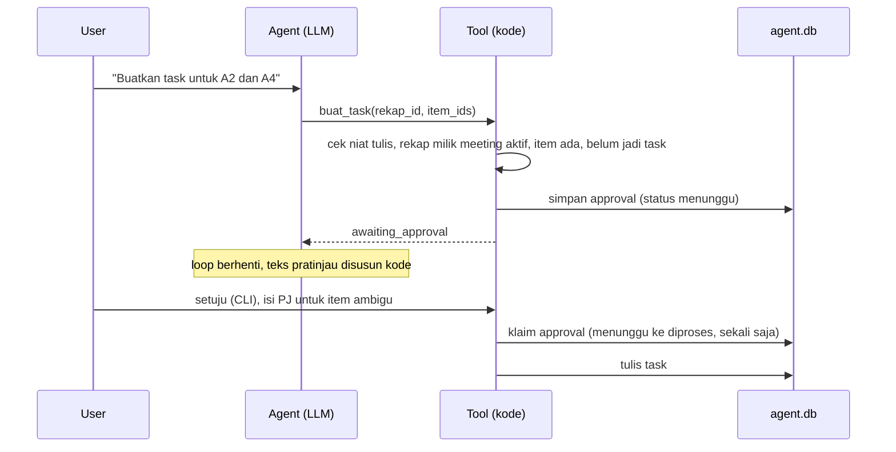

# Tahap 3: Penguatan (aksi tulis, human-in-the-loop, guardrail)

Status: kode selesai, 88 test backend lolos di container (26 di antaranya test agent). Uji end-to-end dengan Groq sudah dijalankan untuk PDF, email dry-run, dan task. Pengiriman SMTP sungguhan belum diuji (belum diukur).
Tanggal: 2026-10-05.

Catatan lanjutan: `buat_laporan_pdf` sudah diganti `ekspor_laporan(format)` dan email laporan bisa melampirkan pdf, docx, atau md. Lihat `docs/04_job_ekspor_ui.md`.

## Keputusan yang diambil di awal tahap

| Hal | Keputusan |
|---|---|
| Kanal pengiriman | Gmail SMTP dengan App Password, default dry-run (file `.eml`). Telegram tidak dibuat. |
| Proyek | Tetap MeetRecall. |
| Cache di drive C | Tidak dihapus. |
| Default teknis | SQLite untuk task dan approval, `fpdf2` untuk PDF, model `openai/gpt-oss-20b`, CLI dulu. |

## Isi tahap ini

| File | Isi |
|---|---|
| `backend/agent/approvals.py` (baru) | Store SQLite `data/agent/agent.db` (tabel `approvals` dan `tasks`), keputusan user, eksekusi fase 2 oleh kode, teks pratinjau |
| `backend/agent/reporting.py` (baru) | Render PDF dari rekap (fpdf2, font DejaVu), isi email, pengiriman dry-run atau SMTP |
| `backend/agent/tools.py` | Tool 4 sampai 7: `buat_laporan_pdf`, `buat_task`, `kirim_email_rekap`, `minta_klarifikasi` |
| `backend/agent/schemas.py` | Model argumen tool baru (Pydantic, `extra="forbid"`) |
| `backend/agent/guardrails.py` | `out_of_scope` (daftar aturan) dan `write_intent` |
| `backend/agent/loop.py` | Status `awaiting_approval`, `needs_human`, `rejected_scope`; rekap aktif lintas giliran; aturan 10 sampai 12 di system prompt |
| `backend/agent/config.py` | Path DB, laporan, outbox, `sources.json`; pengaturan email |
| `backend/scripts/agent_cli.py` | Peninjauan approval di mode chat, `--pending`, `--approve`, `--reject`, `--tasks`, `--rekap-id` |
| `backend/tests/test_agent.py` | 11 test baru |
| `backend/data/sources.json` (baru) | Judul dan URL sumber per meeting; URL tiga video asli masih `null` |
| `backend/Dockerfile.agent` (baru) | Image `meetrecall-agent:latest` = `meetrecall-backend:latest` + `fpdf2==2.8.9` |
| `backend/requirements.txt` | Tambah `fpdf2==2.8.9` |
| `backend/.env.example` | `EMAIL_MODE`, `REPORT_EMAIL_TO`, `SMTP_HOST`, `SMTP_PORT`, `SMTP_USER`, `SMTP_APP_PASSWORD` |

## Alur aksi tulis dua fase



Fase 1 dijalankan di dalam run agent dan hanya menyimpan permintaan. Fase 2 dijalankan CLI di luar LLM. LLM tidak punya tool untuk menyetujui, sehingga teks di transkrip tidak bisa memicu aksi tulis.

## Detail tool

| Tool | Argumen | Perilaku |
|---|---|---|
| `buat_laporan_pdf` | `rekap_id` | Tanpa approval karena hanya menulis file lokal yang bisa dibuat ulang. Isi disusun kode dari rekap: ringkasan, keputusan, action items, isu terbuka, task yang sudah dibuat, statistik, sumber video. Bagian yang belum diekstrak ditulis "Belum dianalisis", bagian kosong ditulis "Tidak ditemukan dalam transkrip". |
| `buat_task` | `rekap_id`, `item_ids` (format `A<nomor>`, maks 20) | Ditolak bila pesan user tidak meminta task, rekap milik meeting lain, item tidak ada, atau semua item sudah menjadi task. Saat persetujuan, user wajib mengisi PJ untuk item ambigu (Enter = item dilewati) dan boleh mengisi tenggat. Sumber nilai dicatat (`transkrip` atau `user`). Duplikat dicegah dengan `UNIQUE (meeting_id, kutipan_norm)`. |
| `kirim_email_rekap` | `rekap_id` saja | Penerima hanya `REPORT_EMAIL_TO`; argumen tambahan seperti `to` ditolak skema. Butuh PDF yang lebih baru dari rekap. Hash SHA-256 PDF disimpan saat permintaan dan dicek saat eksekusi, jadi file yang dikirim sama dengan yang disetujui. Alamat penerima tidak masuk trace (hanya bentuk tersamar `p***@domain` dan hash). |
| `minta_klarifikasi` | `alasan` (enum), `pertanyaan` (5 sampai 300 karakter), `item_ids` | Run berhenti dengan `needs_human`; pertanyaan ditampilkan apa adanya. |

Pengaturan SMTP Gmail mengikuti dokumentasi Google: server `smtp.gmail.com`, port 465 (SSL) atau 587 (TLS), login dengan App Password (https://knowledge.workspace.google.com/admin/gmail/send-email-from-a-printer-scanner-or-app). App Password hanya tersedia bila 2-Step Verification aktif dan dicabut otomatis saat kata sandi akun diganti (https://support.google.com/accounts/answer/185833). Halaman pertama ditulis untuk Google Workspace; batas kirim untuk akun Gmail pribadi tidak saya verifikasi.

## Perubahan terhadap desain Tahap 1

1. `buat_laporan_pdf` tidak memakai approval. Desain bagian 4 menyebut tool 4 sampai 6 dua fase, padahal tabelnya menunjukkan output langsung. PDF hanya file lokal; pengiriman ke luar tetap butuh persetujuan.
2. `kirim_email_rekap` tidak menerima `pdf_path`. Path ditentukan kode dari `rekap_id`, sehingga permukaan injection lebih kecil.
3. Setelah approval dieksekusi, hasilnya tidak dikirim balik ke LLM (diagram bagian 5: `EX2 --> L`). CLI menampilkan hasil dan menambahkannya ke riwayat percakapan sebagai catatan sistem. Lebih sederhana dan tidak butuh panggilan LLM tambahan.
4. Event `approval` untuk keputusan user ditulis sebagai trace tersendiri (`mode: "approval"`) dengan field `trace_id_permintaan`, karena keputusan terjadi di proses lain dan nomor `step` trace asal tidak tersedia. Saat permintaan dibuat, event `approval` dengan `keputusan_user: "menunggu"` dicatat di trace asal.
5. Tenggat yang tidak jelas tidak memblokir pembuatan task (desain: item ambigu ditolak sampai diisi). Yang wajib diisi hanya PJ; tenggat kosong disimpan dengan `sumber_tenggat: "kosong"`. Alasannya: di meeting asli hampir semua action item tidak menyebut tenggat (4 dari 4 pada Ginger Cola).
6. Enum `alasan` di `minta_klarifikasi` ditambah `permintaan_tidak_jelas`.

## Lapisan proteksi aksi tulis dan prompt injection

1. Teks transkrip tetap dibungkus `<transkrip_data>` dan diberi flag `injection_suspect` (Tahap 2).
2. Niat tulis (`write_intent`): `buat_task` dan `kirim_email_rekap` hanya diterima bila pesan user di giliran itu memuat kata yang sesuai (misalnya "task", "buat", "kirim", "email"). Teks transkrip tidak dihitung. Trade-off: jawaban pendek seperti "ya, lanjut" ditolak dan agent harus meminta permintaan eksplisit.
3. Tidak ada argumen penerima, alamat, subjek, atau path di tool tulis.
4. Persetujuan manusia di luar LLM; satu approval hanya bisa dieksekusi sekali (update atomik `menunggu` ke `diproses`).
5. Bila run tersebut membaca chunk yang ditandai mirip instruksi, pratinjau approval memuat peringatan.
6. Rekap dari meeting lain ditolak (`ctx.meeting_id`).

## Penolakan di luar scope

`guardrails.out_of_scope` memakai daftar aturan yang sengaja sempit: menulis kode program dalam bahasa tertentu, cuaca, harga saham atau kripto, dan resep, puisi, atau lelucon. Bila cocok, run berhenti dengan `rejected_scope` tanpa panggilan LLM. Permintaan lain diserahkan ke system prompt (aturan 8). Pertanyaan seperti "Apa keputusan soal kode MR-218?" tidak terkena aturan ini (ada test-nya). Akurasi penolakan pada set skenario: belum diukur (Tahap 4).

## Hasil uji

| Uji | Hasil |
|---|---|
| Unit test agent (container, Python 3.11) | 26 lolos |
| Seluruh test backend di container | 88 lolos |
| "Buat laporan PDF berisi ringkasan, keputusan, dan action items meeting ini, lalu kirim ke email saya." pada Ginger Cola (trace `0aa5bdbf23d9435588cd37e047e95f09`) | Urutan tool benar: ekstrak ringkasan (8 item), keputusan (1), action items (4), `buat_laporan_pdf` (2 halaman), `kirim_email_rekap` berhenti di `awaiting_approval`. 5 iterasi, 8 panggilan LLM, 15.969 token input, 1.137 token output, estimasi 0,0015 USD, 68,9 detik. |
| Persetujuan email (dry-run, penerima placeholder `demo@example.com`) | File `data/agent/outbox/AP23fd9cf61c.eml` dengan lampiran PDF. |
| "Buatkan task untuk action items A2, A3, dan A4" dengan `--rekap-id` (trace `fc07a43fbf10459dad3c0071e107fd66`) | 1 iterasi, langsung `buat_task`. Saat persetujuan, A3 (PJ ambigu) dilewati karena PJ dikosongkan; A2 dan A4 dibuat. |
| Kirim SMTP sungguhan | belum diukur |

Catatan dari uji di atas:
1. Latensi 68,9 detik terutama berasal dari dua panggilan agent yang masing-masing sekitar 22 detik, padahal panggilan lain di bawah 1 detik. Dugaan saya, SDK Groq menunggu lalu mengulang setelah respons 429, karena run ini memakai sekitar 16 ribu token dalam satu menit sedangkan batas free tier 8.000 TPM. Dugaan ini belum diverifikasi dari log SDK. Pemanggilan tool pertama juga memuat model embedding (15,1 detik).
2. Isi ringkasan R1 ("namun agenda masih banyak dibahas") lebih luas dari kutipannya. Verifikasi kode hanya memastikan kutipan ada di transkrip, bukan bahwa parafrase `isi` setia pada kutipan. Masuk ke evaluasi Tahap 4.
3. Saat uji task, input yang saya kirim lewat pipe salah urutan sehingga tenggat A2 terisi "Tim marketing". Baris task itu dihapus dari `agent.db`. Ini menunjukkan isian tenggat dari user tidak divalidasi formatnya; perlu diputuskan apakah divalidasi.

## Cara menjalankan

Image agent dibangun sekali (beberapa detik, hanya menambah fpdf2 di atas image W6):

```bat
docker build -f backend\Dockerfile.agent -t meetrecall-agent:latest backend
```

Untuk email, isi `REPORT_EMAIL_TO` di `backend/.env`. Biarkan `EMAIL_MODE=dry_run` sampai siap mengirim sungguhan; untuk SMTP isi `EMAIL_MODE=smtp`, `SMTP_USER`, dan `SMTP_APP_PASSWORD`.

Chat (cmd, dari folder `Demo project`):

```bat
docker run --rm -it --env-file backend\.env -v "%cd%\backend:/app" -v meetrecallairagchatbot_meetrecall-hf-cache:/root/.cache/huggingface -w /app meetrecall-agent:latest python scripts/agent_cli.py --meeting-id 5c8ff57e-e6b9-4d21-ad36-cf517117ec6e --chat
```

Perintah lain: `--pending`, `--approve <approval_id>`, `--reject <approval_id>`, `--tasks --meeting-id <id>`.

Test:

```bat
docker run --rm -v "%cd%\backend:/app" -w /app meetrecall-agent:latest python -m pytest tests -q
```
