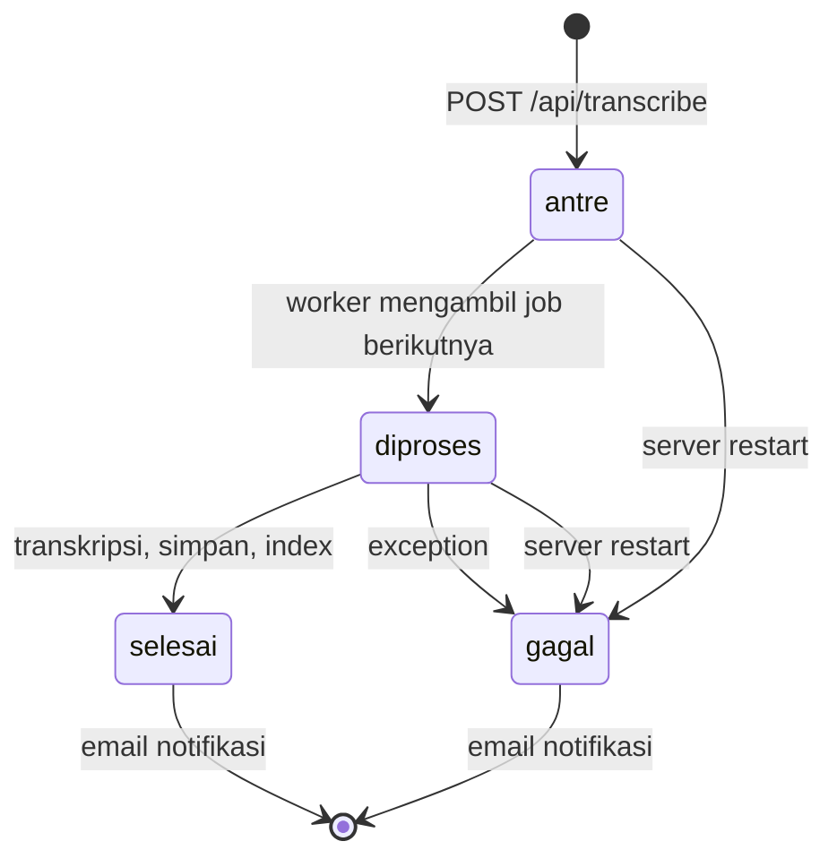

# Tahap 3b: Job transkripsi, ekspor multi-format, dan UI agent

Status: kode selesai, 93 test backend lolos di container. UI diuji di browser lewat `docker compose` dengan Groq nyata. Notifikasi email job dan email laporan sungguhan (SMTP) belum diuji karena `REPORT_EMAIL_TO` belum diisi (belum diukur).
Tanggal: 2026-10-05.

## 1. Pembanding: TurboScribe

Sumber: halaman publik https://turboscribe.ai/ (dibaca 2026-10-05). Dashboard butuh login dan tidak saya buka.

Yang dinyatakan di halaman itu:
- "Powered by Whisper" untuk transkripsi, dengan pilihan mode (cepat, seimbang, paling akurat), speaker recognition, dan terjemahan.
- Ekspor "DOCX, PDF, TXT, captions, and subtitles (SRT, VTT)".
- Pengguna free menunggu lebih lama ("Lower Priority"), jadi ada antrean job dengan prioritas.
- Notifikasi email saat transkrip selesai tidak saya temukan di bagian halaman yang saya baca (sekitar 9.000 karakter pertama); informasi ini dari pengalaman Anda sebagai pengguna.

Apakah TurboScribe memakai agent: tidak ada pernyataan publik soal arsitektur internalnya, jadi tidak bisa dipastikan. Dari perilaku yang terlihat, semua fitur di atas cocok dengan workflow deterministik: unggah, antre, transkripsi, simpan, kirim email, lalu konversi ke format unduhan. Urutannya selalu sama dan tidak ada keputusan yang bergantung pada isi permintaan, sehingga tidak butuh LLM yang memilih langkah. Satu ulasan di halaman itu menyebut "built in ChatGPT prompts"; itu fitur LLM (prompt atas transkrip), belum tentu agent.

Ini sejalan dengan pembagian di desain Tahap 1 bagian 3, yang mengikuti panduan Anthropic "Building effective agents" (https://www.anthropic.com/engineering/building-effective-agents): workflow untuk langkah yang bisa ditentukan di muka, agent hanya untuk bagian yang bergantung pada input.

Yang diambil untuk MeetRecall:

| Ide dari TurboScribe | Di MeetRecall | Jenis |
|---|---|---|
| Antrean job dengan status dan email saat selesai | Job transkripsi `antre`, `diproses`, `selesai`, `gagal`, notifikasi ke `REPORT_EMAIL_TO` | Workflow |
| Unduhan banyak format, nama file mengikuti file asli | `ekspor_laporan(format)`: pdf, docx, md, srt; nama file mengikuti judul video | Tool agent, isi disusun kode |
| Pilihan mode kecepatan vs akurasi | Sudah ada sebagai pilihan provider (gemini, groq, groq_fast, local) | Tidak berubah |
| TXT dan VTT | Tidak dibuat: Markdown sudah mencakup teks biasa, SRT sudah mencakup subtitle | Tidak dibuat |

## 2. Job transkripsi (workflow deterministik)

File: `backend/services/transcription_jobs.py`, dipakai `backend/routers/transcribe.py`.



- Satu worker thread mengambil job satu per satu. Sebelumnya W6 memakai FastAPI `BackgroundTasks`, yang langsung menjalankan setiap upload sehingga beberapa ASR bisa berjalan bersamaan di laptop CPU dan status "antre" tidak pernah ada.
- Status job disimpan di SQLite `data/jobs.db` dan dicerminkan ke `meetings.json` (`queued`, `processing`, `completed`, `failed`), supaya kode W6 dan agent tetap memakai field `status` yang sama.
- Notifikasi email disusun kode: judul, file, provider, lama proses, durasi meeting, jumlah speaker, tautan UI (`UI_URL`), atau penyebab gagal. Penerima hanya `REPORT_EMAIL_TO`. Hasil pengiriman dicatat di kolom `notifikasi`: `terkirim (dry_run)`, `terkirim (smtp)`, `dilewati: REPORT_EMAIL_TO kosong`, atau `gagal: ...`.
- Notifikasi tidak butuh persetujuan karena isinya tetap, penerimanya alamat Anda sendiri, dan Anda memintanya sebagai bagian dari workflow. Ini berbeda dengan email laporan dari agent, yang tetap dua fase.
- Setiap perubahan status dicatat di trace JSONL dengan `mode: "workflow"` dan `trace_id: "job-<meeting_id>"`. Event `job` punya field `fase` (`antre`, `diproses`, `selesai`, `gagal`); event `notifikasi` mencatat hasil pengiriman.
- Endpoint baru: `GET /api/jobs`, `GET /api/jobs/{job_id}`.

Trade-off: antrean disimpan di memori. Job yang masih antre atau diproses saat server mati ditandai `gagal` saat startup (lewat FastAPI lifespan, https://fastapi.tiangolo.com/advanced/events/) dan harus diunggah ulang. Broker seperti Redis dengan RQ atau Celery bisa melanjutkan job, tetapi menambah satu layanan untuk demo satu pengguna.

## 3. `ekspor_laporan(format)` menggantikan `buat_laporan_pdf`

File: `backend/agent/reporting.py`, tool di `backend/agent/tools.py`.

| format | Isi | Library |
|---|---|---|
| `pdf` | Rekap: ringkasan, keputusan, action items, isu terbuka, task, statistik, sumber | fpdf2 2.8.9, font DejaVu |
| `docx` | Rekap yang sama, bisa diedit di Word | python-docx 1.2.0 (https://python-docx.readthedocs.io/en/latest/) |
| `md` | Rekap yang sama sebagai Markdown, untuk wiki atau Notion | stdlib |
| `srt` | Transkrip lengkap per segmen dengan timestamp dan label speaker, bukan rekap | stdlib |

- Satu model dokumen (daftar blok) dirender ke pdf, docx, dan md, sehingga isi ketiganya selalu sama.
- SRT ditolak (`not_found`) bila segmen tidak punya timestamp yang valid. Format SRT tidak punya standar resmi dari satu badan; yang dipakai adalah bentuk umum: nomor cue, `hh:mm:ss,mmm --> hh:mm:ss,mmm`, teks, baris kosong.
- Nama file mengikuti judul video: judul di `data/sources.json` bila ada, kalau tidak nama file upload tanpa ekstensi. Karakter yang tidak sah di Windows (`\ / : * ? " < > |`) dibuang. Contoh: `Business Meeting - Ginger Cola Launch - Rekap.docx`, `... - Transkrip.srt`. File disimpan di `data/agent/laporan/<rekap_id>/`.
- Agent memilih format dari bahasa natural lewat deskripsi tool dan aturan 11 di system prompt: "Word" menjadi docx, "Markdown" menjadi md, "subtitle" atau "caption" menjadi srt, dan pdf bila tidak disebut.
- `kirim_email_rekap` menerima `format` (pdf, docx, md; default pdf) dan melampirkan file ekspor dengan format itu. SRT tidak bisa dikirim karena bukan rekap.
- Modul email dipisah ke `backend/agent/mailer.py` dan dipakai bersama oleh agent dan job.

## 4. UI

Framework yang ada di repo sumber W6: Streamlit multipage (`frontend/app.py` + `frontend/pages/`). Image frontend memakai Streamlit 1.64.0 dan memanggil backend FastAPI lewat `frontend/utils/api_client.py`. Pola yang sama dilanjutkan.

| File | Perubahan |
|---|---|
| `frontend/pages/5_Agent.py` (baru) | Chat agent, kartu persetujuan, unduhan, task, contoh permintaan, panel jejak langkah, status job |
| `frontend/utils/agent_view.py` (baru) | Render jejak langkah dan tabel job |
| `frontend/pages/1_Upload.py` | Status job `ANTRE`, `DIPROSES`, `SELESAI`, `GAGAL`, status notifikasi, tabel antrean |
| `frontend/utils/api_client.py` | Method untuk job dan agent |
| `frontend/app.py` | Kartu dan menu Agent |
| `backend/routers/agent.py` (baru) | API agent untuk UI |

Halaman Agent:
- **Panel jejak langkah (kanan):** satu kotak per event trace, berurutan. Isinya keputusan LLM per iterasi ("LLM memutuskan memanggil tool X" atau "menjawab tanpa tool"), token, latensi, tool beserta argumen dari LLM dan ringkasan hasil yang dikembalikan ke LLM, guardrail (lolos, gagal, atau flag), approval, dan ringkasan akhir (iterasi, panggilan LLM, token, biaya, latensi). Bisa ditampilkan sebagai tabel, dan bisa memilih run sebelumnya.
- **Kartu persetujuan:** muncul untuk setiap approval yang menunggu di meeting itu, termasuk yang dibuat dari CLI. Untuk task, ada input PJ wajib bagi item ambigu dan input tenggat opsional. Tombol "Setujui dan jalankan" dan "Tolak" memanggil `POST /api/agent/approvals/{id}`; agent tidak punya tool yang menjangkau endpoint itu. Hasilnya masuk ke chat sebagai catatan sistem.
- **Unduhan laporan:** satu tombol per file ekspor rekap aktif. Backend hanya menyajikan nama file yang ada di daftar ekspor, sehingga path buatan tidak bisa keluar dari folder.
- **Status job:** panel sidebar diperbarui otomatis tiap 5 detik dengan `st.fragment(run_every=5)` (https://docs.streamlit.io/develop/api-reference/execution-flow/st.fragment), tanpa memuat ulang chat.

`docker-compose.yml`: backend memakai `Dockerfile.agent` (image `meetrecall-agent:latest`), dan kode backend serta frontend di-bind dari host, sehingga perubahan halaman tidak perlu build ulang image.

## 5. Hasil uji

| Uji | Hasil |
|---|---|
| Seluruh test backend di container | 93 lolos. Baru di tahap ini: ekspor docx, md, srt dan penamaan file, lampiran email sesuai format, job runner (antre ke selesai, gagal, recover setelah restart, notifikasi dry-run), API agent dengan TestClient (chat, approval, unduhan, path traversal ditolak) |
| UI: "Buat laporan Word berisi ringkasan, keputusan, dan action items" pada Ginger Cola (trace `1e1ae3a13c6749478b949beb5dd4adce`) | Urutan tool: ekstrak ringkasan, keputusan, action items, lalu `ekspor_laporan` dengan format docx. File `Business Meeting - Ginger Cola Launch - Rekap.docx` (37,3 KB) muncul di panel unduhan. 5 iterasi, 16.785 token input, 1.169 output, 0,0016 USD, 104,3 detik. |
| UI: "Buatkan task untuk action items A2, A3, dan A4" (trace `ead5f036b16a4eb3a21785254f4df6b1`) | 1 iterasi, 0,8 detik. A4 dilewati karena kutipannya sudah menjadi task T2 dari uji CLI, walaupun rekapnya berbeda. Setelah PJ A3 diisi di kartu persetujuan dan disetujui, T3 dan T4 dibuat. |
| Endpoint unduhan DOCX | HTTP 200, MIME Word, 38.182 byte |
| Job nyata: nada sinus 3 detik, provider `groq_fast` | `antre` ke `selesai` dalam 0,5 detik; notifikasi `dilewati: REPORT_EMAIL_TO kosong`. Meeting uji dan baris job dihapus setelahnya. |
| Notifikasi email job sungguhan dan email SMTP | belum diukur |

Catatan:
1. Latensi 104 detik pada run pertama terutama berasal dari dua panggilan agent terakhir (26,8 dan 20,9 detik), sedangkan panggilan lain di bawah 2 detik, kecuali satu ekstraksi 7,0 detik. Polanya sama dengan Tahap 3, dan sumbernya masih dugaan (lihat catatan 1 di `03_penguatan.md`). Untuk demo, ada dua jalan: jalankan permintaan bertahap, atau pakai tier Groq berbayar. Keputusannya ada di Anda.
2. Whisper menghasilkan satu segmen teks dari nada sinus tanpa ucapan. Ini perilaku ASR, bukan bug job, dan menjadi contoh skenario "transkripsi kurang jelas" untuk evaluasi.
3. Ditemukan bug lama dari W6: `DELETE /api/transcript/{id}` mengembalikan `JSONResponse(status_code=204, content=None)`, sehingga server mencatat "Response content longer than Content-Length". Diperbaiki menjadi `Response(status_code=204)`.

## 6. Cara menjalankan

```bat
docker build -f backend\Dockerfile.agent -t meetrecall-agent:latest backend
docker compose up -d
```

UI: http://localhost:8503 (menu Agent), API: http://localhost:8090/docs. Isi `REPORT_EMAIL_TO` di `backend/.env` untuk notifikasi job dan email laporan, lalu `docker compose restart backend`.

## 7. Lanjutan (keputusan pengguna 2026-10-05)

Validasi tenggat saat persetujuan task (`agent/approvals.py`, `check_deadline`):
- Kosong, atau `YYYY-MM-DD` dan tanggal harus valid (`2026-02-30` ditolak; `31/10/2026`, `besok`, `20261031` ditolak).
- Tanggal yang sudah lewat diterima dengan peringatan, yang tampil di hasil approval dan di chat.
- Validasi berjalan sebelum approval di-klaim, sehingga salah ketik tidak menghabiskan permintaan: API mengembalikan 422, approval tetap `menunggu`, CLI meminta ulang. Tenggat dari transkrip ("12 Oktober") tidak diubah; hanya isian pengguna yang divalidasi.
- 3 test baru, total 96 lolos. Tampilan pesan 422 di kartu UI belum saya coba di browser (hanya jalur API dan test).

Data: URL YouTube tiga video asli sudah masuk `data/sources.json` dan `docs/sumber_data.md`. File GitLab lokal (28,7 menit) ditranskripsi lewat job Gemini dalam 94 detik.

Uji awal agent pada meeting GitLab ("Apa saja action items meeting ini?", 52,5 detik):
1. Ekstraksi action items gagal dua kali dengan `json_validate_failed` (retry internal juga gagal), lalu agent memanggil tool lagi dan berhasil; hanya 1 item lolos, 2 kutipan ditolak validasi. Meeting 28 menit hanya diwakili maksimal 12 chunk (`EXTRACT_MAX_CHUNKS`), sekitar 720 dari 4.890 kata; dugaan saya recall rendah karena batas ini, belum diukur. Masuk Tahap 4 (bandingkan batas chunk atau ekstraksi bertahap).
2. `totals` di trace bernilai `null` untuk token dan biaya bila ada satu panggilan LLM yang gagal (desain: tidak menebak). Akibatnya biaya run yang sempat error tidak terlihat; perlu diputuskan apakah dijumlahkan dari panggilan yang berhasil dengan penanda.

## 8. Uji pengiriman SMTP sungguhan (2026-10-06)

Pengirim `meetrecall.ai@gmail.com` (akun Google baru dengan App Password), nama tampilan "MeetRecall AI" (`MAIL_FROM_NAME`), penerima `REPORT_EMAIL_TO` (alamat milik pengguna, disamarkan di log). `.env` tidak saya baca; status variabel dicek dari dalam container (terisi atau kosong).

| Uji | Hasil |
|---|---|
| Notifikasi job: nada 3 detik, provider `groq_fast` | Job `selesai` dalam 11,0 detik, kolom `notifikasi`: `terkirim (smtp)` |
| Email laporan: "Kirim rekap versi Word ke email saya" dengan rekap Ginger Cola | Agent langsung memanggil `kirim_email_rekap` dengan format docx (1 iterasi) dan berhenti di `awaiting_approval`. Setelah disetujui lewat endpoint approval: `status ok`, mode `smtp`, lampiran `Business Meeting - Ginger Cola Launch - Rekap.docx` |
| Alamat penerima utuh di trace | Tidak ditemukan (hanya bentuk tersamar) |
| Tampilan di inbox (nama pengirim, lampiran terbuka, subjek) | belum dikonfirmasi pengguna |

Penyebab `.env` tidak terbaca sebelumnya: file belum tersimpan saat container dibuat ulang. Perlu dicatat bahwa `docker compose restart` tidak membaca ulang `env_file`; perubahan `.env` butuh `docker compose up -d --force-recreate backend`.

Konfirmasi pengguna 2026-10-06: kedua email masuk ke inbox, pengirim tampil "MeetRecall AI", lampiran Word terlihat dengan judul video.

Batas kirim Gmail: halaman bantuan Google (https://support.google.com/mail/answer/22839) menyebut maksimal 500 email per hari dan 500 penerima per email untuk akun @gmail.com; bila terlampaui, pengiriman bisa dilanjutkan dalam 1 sampai 24 jam. Halaman itu tidak menjelaskan apakah batas untuk SMTP aplikasi pihak ketiga berbeda, jadi angka 500 saya anggap perkiraan. Batas 2.000 per hari yang tercantum di halaman SMTP Google berlaku untuk Google Workspace, bukan akun pribadi. Pemakaian demo ini (satu email per job dan per laporan) jauh di bawah batas itu.

Perbaikan tampilan: alamat tersamar `m***@gmail.com` terbaca sebagai Markdown di kartu persetujuan; sekarang dibungkus kode. Container frontend sempat mati setelah backend dibuat ulang dengan `--force-recreate`; jalankan `docker compose up -d` (bukan hanya backend) agar keduanya hidup.

## 9. Kualitas ekstraksi pada meeting panjang dan URL sumber (2026-10-06)

Pemicu: pada meeting GitLab (28,7 menit), pengguna melihat respons agak lama dan action item "go ahead and do that work and then let me know" yang tidak konkret. Penyelidikan lewat trace dan transkrip:

| Temuan | Penyebab | Perbaikan |
|---|---|---|
| Dua komitmen asli ditolak (10:23 "I I I'll just manually put those up once you do it"; 25:42 "I I'll definitely just wait for you and Andre...") | Model merapikan ucapan lisan (membuang "I I", "I'll" jadi "I will"); validator butuh kecocokan persis | `snap_quote` (guardrails): cari rentang transkrip yang cocok setelah mengabaikan pengulangan kata dan tanda baca (kemiripan minimal 0,8, awal dan akhir cocok), lalu pakai rentang itu apa adanya. Kutipan di laporan tetap kata asli pembicara. Jumlah perbaikan dicatat di trace (`diperbaiki_ke_kata_asli`). `quote_in_text` juga mengabaikan pengulangan kata. Prompt meminta salin kata demi kata |
| A1 "go ahead and do that work" lolos | Kriteria "permintaan kepada seseorang" terlalu longgar; kutipan dipakai sebagai isi | Prompt: arahan umum tanpa tugas konkret bukan action item; `isi` harus konkret, bukan salinan kutipan |
| Hanya 12 chunk dari sekitar 80 yang dilihat | Batas `EXTRACT_MAX_CHUNKS` | Sampai 3 panggilan ekstraksi (`EXTRACT_MAX_CALLS`) per jenis, 12 chunk per panggilan, urut relevansi; `top_k` per query naik dari 4 ke 6. Meeting pendek tetap 1 panggilan. Batch yang gagal dilaporkan (`peringatan_parsial`), bukan disembunyikan |
| `json_validate_failed` (Groq 400, hasil kosong) | Sisi penyedia API | Retry menjadi 3 kali |
| Token tampil 0 di UI, `totals` null | Satu panggilan gagal membuat seluruh total null | `totals` menjumlahkan panggilan yang berhasil dan menambah `llm_call_gagal`; UI menampilkan "n/a" bila tidak ada data |
| `kutipan_jawaban_akhir: fail` pada tabel | Regex menganggap teks antar sel tabel sebagai kutipan | Kutipan tidak boleh melintasi baris atau pemisah tabel (`|`) |
| Respons 52,5 detik | Cold start model embedding setelah container dibuat ulang, ditambah panggilan gagal | Model embedding dipanaskan saat startup (thread di lifespan) |

Hasil ulang pertanyaan yang sama ("Apa saja action items meeting ini?") pada meeting GitLab setelah perbaikan: 9,0 detik, 4 panggilan LLM, 0 gagal, 8.051 token masuk dan 746 keluar (0,0008 USD), 2 batch, 3 action item, semua guardrail lolos. Item: A1 Andre akan bicara dengan Tim (04:45), A2 Sean diminta meninjau tech debt (27:20), A3 Speaker 1 menambah agenda (28:21, tenggat "next week"). Saya mencocokkan A1 dan A2 dengan transkrip: sesuai. Komitmen 10:23 tidak muncul pada run ini. Karena itu recall dan presisi tetap belum diukur; tidak ada label manusia untuk meeting ini, dan hasil antar run bisa berbeda. Diukur di Tahap 4.

URL YouTube sumber (tingkat 1): kolom opsional di halaman Upload dan field `source_url` di `POST /api/transcribe` (`agent/sources.py`).
- Hanya metadata. Video tidak diunduh (ketentuan YouTube membatasi pengunduhan, https://www.youtube.com/t/terms). File tetap diunggah.
- Bentuk yang diterima: `youtu.be/ID`, `youtube.com/watch?v=ID`, `/live/ID`, `/shorts/ID`, `/embed/ID`, host youtube.com, m., music., youtu.be. Selain itu ditolak 400 sebelum file disimpan.
- Alamat yang ditempel tidak pernah diakses. Hanya ID 11 karakter yang diambil, lalu kode memanggil oEmbed YouTube sendiri, sehingga URL buatan tidak bisa mengarahkan server ke host lain.
- Judul dan kanal masuk `sources.json` (ditulis atomik). Judul video dipakai di nama file laporan, subjek email, dan notifikasi job. Bila oEmbed gagal, tautan tetap tersimpan dan laporan memakai nama file.
- Uji: nada 3 detik dengan https://youtu.be/z-8o9sp8YIA menghasilkan judul "Business English Conversations | ESL Business Meeting Conversation" dan kanal "Learn English by Pocket Passport"; URL `evil.example` ditolak 400. Data uji dihapus.
- Memproses langsung dari URL tanpa upload (tingkat 2) belum dikerjakan; Gemini menerima URL YouTube publik tetapi belum terbukti untuk model transkripsi yang dipakai.

Tes: 105 lolos di container.

## 10. Durasi laporan lengkap dan niat tulis lintas giliran (2026-10-06)

Run pengguna di UI: meeting GitLab 28,7 menit, "Kirim rekap PDF ke email saya" (agent bertanya isi laporan, 1,3 detik, tanpa tool), lalu "semua poin dijadikan dalam bentuk .pdf ya" (trace `882effcc`).

| Langkah | Latensi |
|---|---|
| Ekstraksi ringkasan (2 batch, 13 poin) | 2,2 detik |
| Panggilan agent berikutnya | 10 detik |
| Ekstraksi keputusan (2 batch, 0 poin) | 25 detik |
| Panggilan agent | 30 detik |
| Ekstraksi action items (2 batch, 3 poin) | 32,8 detik |
| Panggilan agent, ekspor PDF (0,8 detik), panggilan agent, kirim_email_rekap ditolak, panggilan agent | sekitar 28, 29, 30 detik |
| **Total** | **189 detik**, 12 panggilan LLM, 0 gagal, 29.894 token masuk dan 2.827 keluar |

Lima detik pertama cepat, lalu setiap panggilan menunggu 10 sampai 30 detik. Total sekitar 32.700 token dalam sekitar 3 menit, jauh di atas batas 8.000 token per menit free tier (https://console.groq.com/docs/rate-limits), jadi pola ini konsisten dengan penundaan oleh batas token per menit. Itu kesimpulan dari pola latensi; header rate limit dari respons belum diperiksa. Perkiraan saya sebelumnya (30 detik sampai 2 menit) terlalu optimistis. Laporan lengkap pada meeting 28 menit: sekitar 3 menit pada free tier.

Ekstraksi keputusan mengembalikan 0 poin pada meeting ini, padahal ada kalimat seperti "we're going to leave it and we're going to say that the goal is to get it merged by the 22nd" (sekitar 19:53). Kemungkinan recall miss; belum diukur, masuk Tahap 4.

`write_intent` ditolak pada run itu karena pesan di giliran tersebut tidak meminta kirim, padahal pengguna meminta kirim satu giliran sebelumnya. Perubahan: niat tulis dicek terhadap pesan pengguna saat ini dan pesan pengguna tepat sebelumnya (`agent/loop.py`). Giliran lebih lama, teks jawaban agent, dan teks transkrip tetap tidak dihitung, dan setiap pengiriman tetap butuh klik persetujuan. Trade-off: risiko bertambah tipis (satu pesan pengguna sebelumnya), imbalannya percakapan multi-giliran tidak patah. Test baru: 106 lolos.

## 11. Tata letak laporan, waktu WIB, transkrip, palet Tritronik (2026-10-06)

Pemicu: PDF kita dibandingkan dengan laporan referensi pengguna (Nexus Daily Issue Summary, 5 halaman). Perbedaan yang saya amati dari render kedua file: referensi memakai font sans-serif bergaya Arial, judul biru besar dengan subjudul abu-abu, garis pemisah tipis, pita berwarna untuk judul bagian, daftar bernomor yang rapat, dan footer kiri dan kanan. Laporan kita memakai DejaVu Sans yang lebar, kepala dokumen berisi data teknis (nama file, `meeting_id`), semua bagian setara, statistik berupa baris teks, dan tanpa nomor halaman. Logo tidak dipakai (permintaan pengguna).

Perubahan (`agent/reporting.py`, `backend/Dockerfile.agent`):
- Font Liberation Sans (setara Arial; paket `fonts-liberation`, ditambahkan di Dockerfile.agent). Fallback DejaVu, lalu font inti.
- Model dokumen kaya (judul, meta, ringkasan eksekutif, bagian, tabel, transkrip) yang dirender ke PDF, DOCX, dan Markdown, sehingga isinya sama.
- Header ringkas (Sumber, Durasi, Pembicara) tanpa `meeting_id` dan nama file; `rekap_id` dipindah ke footer.
- Ringkasan eksekutif dari kode (jumlah poin per bagian dan daftar item yang perlu konfirmasi), tanpa LLM.
- Pita berwarna per bagian, poin diurutkan menurut waktu bicara, kutipan miring dengan garis samping serta pembicara dan waktu. Ringkasan, keputusan, dan isu bernomor 1 sampai n; action items tetap A1, A2 karena ID itu dipakai untuk membuat task.
- Tabel statistik pembicara (waktu bicara mm:ss, proporsi, giliran, kata) dan tabel task.
- Footer: "MeetRecall AI | dibuat ... | rekap ..." dan "Halaman n dari N"; running header di halaman berikutnya.
- Transkrip lengkap di bagian akhir: tiap giliran memuat timestamp dan pembicara; segmen berurutan dari pembicara yang sama digabung, maksimal 45 detik per paragraf. Argumen `sertakan_transkrip` (default true) bisa dimatikan agent bila pengguna meminta laporan tanpa transkrip. Meeting GitLab 28,7 menit menghasilkan PDF 13 halaman (75 KB), DOCX 49 KB, MD 32 KB.
- Waktu yang tampil ke pengguna memakai WIB (UTC+7, offset tetap karena Indonesia tanpa DST; `REPORT_TZ_OFFSET_HOURS` dan `REPORT_TZ_LABEL` bisa diubah): isi dan footer laporan, email notifikasi job, tabel job di UI. Data tersimpan dan trace tetap UTC.
- Palet dari https://tritronik.com/ (dibaca 2026-10-06 dari `theme-color` dan warna komputasi halaman): biru tema #4E72C2 (judul, tautan, timestamp), navy #344574 (pita bagian), biru #5F8ACF (garis kutipan), latar #F5FAFE (header tabel), abu #5E636E, garis #C2C9D6. Situs memakai font DM Sans; tidak dipasang, jadi laporan tetap Liberation Sans.

Pemeriksaan visual: render halaman PDF ke gambar dan dibandingkan dengan referensi. Tabel sempat berwarna biru karena warna isi pita bocor ke sel tabel; sudah diperbaiki. Tampilan DOCX dan Markdown tidak saya lihat sebagai gambar (hanya diuji lewat teks).

Tes: 111 lolos.

## 12. Error "Tool call validation failed" pada percakapan tanpa rekap (2026-10-06)

Gejala di UI: "Model tidak dapat dihubungi: Error code: 400 ... Tool call validation failed ... parameters for tool kirim_email_rekap did not match schema ... /rekap_id: '5c8ff57e-e6b9-4d21...". Permintaan: laporan lalu kirim email, pada percakapan baru.

Penyebab, tiga lapis:
1. Percakapan baru belum punya rekap, tetapi system prompt tidak menyebutnya, sehingga model mengisi `rekap_id` dengan `meeting_id` (yang memuat tanda hubung).
2. Skema tool mensyaratkan `rekap_id` huruf dan angka saja (`pattern`). Groq memvalidasi argumen tool terhadap skema di sisi mereka dan menjawab 400 sebelum kode kita berjalan, sehingga pesan koreksi dari tool tidak pernah sampai ke model.
3. Loop mengulang permintaan yang sama persis (1 kali retry), gagal sama, lalu berhenti sebagai `llm_error`.

Perbaikan:
- Aturan format `rekap_id` dihapus dari skema yang dikirim ke penyedia. Format tetap diperiksa kode; pesan tool kini berbunyi bahwa `rekap_id` berbeda dari `meeting_id`, baru ada setelah `ekstrak_poin_meeting`, dan model harus mengekstrak dulu.
- Konteks yang selalu dilihat model menyebut "Belum ada rekap aktif" bila memang belum ada.
- Penolakan argumen oleh penyedia kini dianggap kesalahan yang bisa dipulihkan: loop menambah pesan koreksi ke model dan mencoba lagi (maksimal 2 kali per run, dicatat sebagai guardrail `tool_call_ditolak_provider`). Bila tetap gagal, run berhenti `llm_error`. Test pertama untuk jalur ini menemukan bug pada perbaikan saya sendiri (loop tidak berhenti dan berakhir `max_iterations`); sudah diperbaiki.

Uji ulang skenario yang sama (Ginger Cola, percakapan baru, "Buat laporan PDF berisi ringkasan, keputusan, dan action items, lalu kirim ke email saya"): 5 iterasi, 8 panggilan LLM, 0 gagal, ekstraksi tiga jenis, `ekspor_laporan` pdf, berhenti di `awaiting_approval` untuk email; 17.287 token masuk dan 924 keluar (0,0016 USD), 77,9 detik (dominan menunggu batas token per menit). Pengiriman setelah persetujuan tidak saya jalankan pada uji ini. Tes: 116 lolos.

## 13. Beberapa format dalam satu email (2026-10-06)

Pemicu: pengguna meminta PDF dan Word, tetapi email hanya melampirkan PDF. Penyebab: `kirim_email_rekap` (dan `ekspor_laporan`) menerima satu `format` per panggilan, sehingga agent memilih satu.

Perubahan:
- `ekspor_laporan(formats)` dan `kirim_email_rekap(formats)` menerima daftar format (maksimal 4 dan 3, duplikat dibuang, urutan dipertahankan). Email melampirkan semua file; SRT tidak bisa dilampirkan karena bukan rekap.
- Kartu persetujuan dan teks persetujuan mencantumkan setiap lampiran. Hash setiap file diperiksa saat eksekusi, dan satu file yang berubah membatalkan seluruh email.
- Permintaan persetujuan yang dibuat sebelum perubahan ini (satu lampiran) tetap bisa dieksekusi (`attachments_of`).
- Hasil `ekspor_laporan` kini berbentuk `{files: [...]}`.
- System prompt: bila pengguna menyebut lebih dari satu format, isi semuanya dalam satu panggilan.

Uji (Ginger Cola, percakapan baru, "Buat laporan PDF dan Word ... lalu kirim keduanya ke email saya"): 6 iterasi, 9 panggilan LLM, 0 gagal, 108 detik. Panggilan `ekspor_laporan` pertama ditolak (`invalid_args`, belum ada rekap), model memperbaiki sendiri dengan mengekstrak dulu lalu `ekspor_laporan` `["pdf","docx"]` dan `kirim_email_rekap` `["pdf","docx"]`, berhenti di persetujuan dengan dua lampiran (PDF 49,4 KB dan DOCX 39,0 KB). Pengiriman setelah persetujuan pada permintaan ini belum saya jalankan. Tes: 119 lolos.

## 14. Alur agent dan tampilan chat (2026-10-06)

Pemicu: tangkapan layar pengguna pada permintaan "buat laporan berupa word dan pdf kirim sekaligus ke email saya ... dengan isi yang lengkap". Pengamatan: email hanya melampirkan PDF (sudah diperbaiki, bagian 13); agent hanya memanggil ekstraksi 2 kali sehingga laporan "lengkap" masih punya bagian belum dianalisis; teks persetujuan menyatu satu paragraf; catatan sistem tampil sebagai gelembung chat dengan awalan "[Catatan sistem]"; caption mengulang nama tool.

Alur agent:
- `ekstrak_poin_meeting` menerima `jenis="semua"` (ringkasan, keputusan, action items, isu terbuka dalam satu langkah; hanya jumlah per jenis dan daftar action items yang kembali ke model). Satu langkah menggantikan beberapa putaran agent, yang masing-masing menunggu batas token per menit. Jenis yang gagal dilaporkan (`peringatan_parsial`), tidak disembunyikan.
- `ekspor_laporan` (pdf, docx, md) menolak laporan yang bagiannya belum dianalisis dan menyebut apa yang harus dilakukan; `izinkan_bagian_kosong=true` hanya untuk laporan sebagian yang sengaja diminta. SRT tidak terkena aturan ini. Aturan yang hanya berupa kalimat di system prompt tidak dipatuhi model (ekstraksi tetap 2 kali), sehingga dijadikan pemeriksaan di kode.
- System prompt: pakai bahasa sehari-hari, tanpa nama tool, `meeting_id`, atau `rekap_id` kecuali ditanya (uji jawaban "Apa saja yang bisa kamu bantu" sebelumnya menyebut ID mentah dan nama tool).

Tampilan (hanya di folder W78; project W6 tidak disentuh):
- Avatar: ikon Material `auto_awesome` (bintang berkilau bergaya Gemini) untuk agent dan `person` untuk pengguna, berlatar gradasi #4E72C2 ke ungu. Dipakai di halaman Agent dan AI Chat. Robot tidak dipilih karena kurang terasa sebagai AI (pendapat pengguna).
- Streamlit menandai semua avatar kustom sebagai `stChatMessageAvatarCustom` tanpa `aria-label`, sehingga CSS lama (bubble pengguna di kanan) tidak menempel; pesan pengguna kini membawa penanda tak terlihat `.mr-user` dan CSS memakai `:has()`. Dicek lewat DOM: pesan pengguna `row-reverse`, pesan agent `row`.
- Pesan persetujuan di chat menjadi satu kalimat; detail dan tombol ada di kartu. Hasil klik tombol tampil sebagai kotak status (hijau, biru, atau merah), bukan gelembung chat. Teks persetujuan dari backend memakai butir daftar agar Markdown tidak menyatukan barisnya.
- Caption run: "Menunggu persetujuan Anda | ekstrak_poin_meeting x2, ekspor_laporan | 5 iterasi | 41,9 dtk" (nama tool dihitung, tidak diulang; sebelumnya "anda" menjadi huruf kecil karena `capitalize()`).
- Pesan setelah pengiriman menyebut hasil sebenarnya: "sudah dikirim lewat SMTP" atau, pada dry_run, "belum dikirim, hanya disimpan sebagai file".

Tes: 122 lolos. Belum saya jalankan ulang permintaan laporan penuh di UI setelah perubahan `jenis="semua"` (menghemat kuota Groq; terpakai sekitar 55% dari batas harian sebelum uji ini); jalur itu diuji dengan LLM tiruan.

## 15. Permintaan persetujuan menumpuk dan bubble pesan (2026-10-06)

Gejala dari tangkapan layar pengguna: dua kartu persetujuan email untuk meeting yang sama (padahal emailnya sudah terkirim dari kartu lain), dan bubble pesan pengguna di AI Chat punya baris kosong di atas teks.

Penyebab dan perbaikan:
- Setiap run agent membuat permintaan persetujuan baru, tetapi yang lama tidak pernah ditutup. Akibatnya kartu lama tetap bisa diklik dan bisa mengirim email ganda. Perbaikan: saat permintaan baru dibuat (`ApprovalStore.create`), permintaan yang masih menunggu untuk meeting dan aksi yang sama otomatis berstatus `kedaluwarsa` dan tidak bisa dieksekusi. Aksi atau meeting lain tidak terpengaruh. Satu test baru. Data yang sudah menumpuk dibersihkan dengan aturan yang sama: dari 9 permintaan, 7 sudah dieksekusi dan 1 dikedaluwarsakan (`AP305b4f1695`), tersisa `APba178333eb` yang menunggu.
- Penanda peran `.mr-user` ditulis sebagai elemen Markdown tersendiri sehingga menambah satu baris kosong. Sekarang penanda digabung ke teks dalam satu elemen (`user_html`), dengan teks pengguna di-escape karena dirender memakai `unsafe_allow_html`.

Tes: 123 lolos.

## 16. Template Word disamakan dengan PDF (2026-10-06)

Tujuan pengguna: versi Word selaras dengan PDF, supaya enak diedit dan hasil ekspor PDF dari Word tetap sesuai.

`_render_docx` (agent/reporting.py) ditulis ulang dengan struktur yang sama dengan PDF:
- Halaman A4 dengan margin 18 mm (python-docx secara bawaan memakai Letter); font Arial (setara Liberation Sans pada PDF dan ada di setiap Word); warna palet Tritronik yang sama.
- Judul memakai gaya Heading 1 (biru, 24 pt), tiap bagian memakai gaya Heading 2 berlatar navy dengan teks putih (pita), sehingga panel navigasi Word tetap berfungsi.
- Header berjalan mulai halaman 2 (halaman pertama dibedakan), footer "MeetRecall AI | dibuat ... | rekap ..." dan "Halaman n dari N" dari field PAGE dan NUMPAGES Word.
- Meta (Sumber sebagai hyperlink aktif, Durasi, Pembicara), ringkasan eksekutif, kutipan miring dengan garis samping biru dan baris pembicara serta waktu, tabel statistik dan tabel task dengan header berlatar muda dan garis horizontal, transkrip per giliran.
- Elemen XML disisipkan sesuai urutan skema OOXML (ECMA-376). Versi pertama menaruh pita dan garis di akhir elemen paragraf, yang berisiko membuat Word menolak file; sudah diperbaiki lewat `_insert_ordered` dan diperiksa programatik pada file hasil: 0 elemen di luar urutan, 6 pita berlatar navy, 16 kutipan bergaris samping, 1 hyperlink, field halaman ada di footer.

Batas verifikasi: tampilan DOCX belum saya lihat sebagai gambar. Percobaan merender lewat Microsoft Word 2024 yang terpasang (otomasi COM, ekspor ke PDF) macet karena Word menunggu dialog yang tidak terlihat. Proses Word yang saya mulai saya hentikan (Word tidak sedang berjalan sebelumnya, tidak ada dokumen pengguna yang tersentuh). Yang diperiksa hanya struktur file; kemiripan visual dengan PDF perlu dikonfirmasi pengguna dengan membuka file di Word. Jumlah halaman di Word bisa sedikit berbeda dari PDF karena mesin tata letaknya berbeda.

Tes: 123 lolos.
