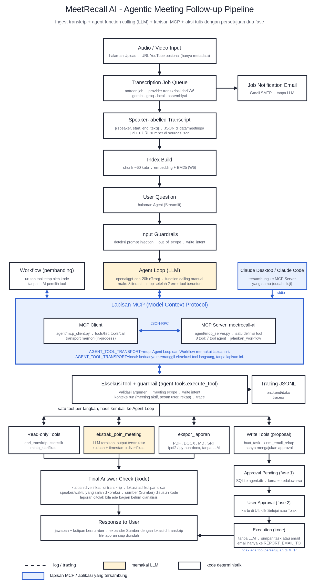

# MeetRecall AI: alur end-to-end

Dokumen pembacaan alur proyek dari rekaman meeting sampai tindak lanjut (laporan, task, email). Ditulis 2026-10-16.
Bagian 1-3 menjelaskan alur data, 4-6 agent dan MCP, 7-8 keputusan desain dan cara menjalankan.

## Flowchart

Flowchart lengkap ada di `docs/flowchart_end_to_end.png` (versi sebelum MCP: `flowchart_end_to_end_sebelum_mcp.png`). Biru = lapisan MCP atau aplikasi lain, kuning = memakai LLM, putus-putus = log tracing. Jalur tanpa MCP (local) dijelaskan di teks dalam kotak biru.



## 1. Gambaran satu kalimat

Rekaman atau transkrip meeting diubah menjadi transkrip bertimestamp, diindeks, lalu bisa ditanya (AI Chat) atau
ditindaklanjuti oleh agent (ringkasan, keputusan, action items, laporan PDF/DOCX/MD, task, email ke alamat sendiri).
LLM memilih langkah dan menulis; kode memverifikasi, menyusun, dan menjaga batas.

## 2. Komponen

| Lapisan | Isi | Lokasi |
|---|---|---|
| Frontend | Streamlit: Upload, Hasil, AI Chat, Retrieval Lab, Agent | `frontend/pages/` (port 8503) |
| Backend | FastAPI: transcribe, rag, agent | `backend/routers/` (port 8090) |
| Layanan W6 | transkripsi, chunking, embedding, FAISS + keyword (hybrid), RAG chain | `backend/services/` |
| Agent W7-W8 | loop, 7 tool, guardrail, approval, laporan, email, trace, workflow, MCP | `backend/agent/` |
| Data | meeting, indeks FAISS, rekap, laporan, trace, `agent.db` | `backend/data/` (bind mount) |
| LLM | `openai/gpt-oss-20b` via Groq (agent dan ekstraksi) | `agent/llm_client.py` |

## 3. Alur data: dari rekaman sampai bisa dicari

```
Upload (audio/video/teks)  ->  Transkripsi (Gemini atau Whisper lokal + pyannote)  ->  segmen (speaker, mulai, selesai, teks)
        ->  chunking  ->  embedding (paraphrase-multilingual-MiniLM)  ->  FAISS + indeks keyword  ->  meeting siap
```

1. **Upload** (halaman 1): file media atau transkrip. Pekerjaan transkripsi berjalan sebagai job (`jobs.db`) dan statusnya bisa dipantau.
2. **Hasil** (halaman 2): transkrip per segmen, speaker bisa diedit.
3. **Indeks**: transkrip dipotong menjadi chunk, di-embed, disimpan di FAISS per meeting, plus indeks keyword. Pencarian memakai hybrid.
4. **AI Chat** (halaman 3, W6): satu panggilan LLM berbasis RAG, tanpa tool dan tanpa persetujuan. Cocok untuk pertanyaan tentang isi meeting.
5. **Retrieval Lab** (halaman 4): evaluasi pencarian (metrik retrieval).

## 4. Alur agent (halaman 5)

```
Pesan user
  -> guardrail input (panjang, meeting valid)  -> guardrail scope (di luar cakupan: ditolak tanpa panggil LLM)
  -> LOOP (maks 8 iterasi, berhenti setelah 2 error tool berturut-turut)
        LLM memilih tool  ->  validasi argumen  ->  meeting scope  ->  tool jalan  ->  hasil kembali ke LLM
        |-- awaiting_approval : berhenti, teks persetujuan disusun KODE
        |-- needs_human       : berhenti, pertanyaan ke user
        `-- jawaban akhir     : kutipan di jawaban diperiksa terhadap transkrip
  -> trace JSONL (run_start, llm_call, tool_call, guardrail, approval, run_end)
```

### Tujuh tool

| Tool | Fungsi | Sifat |
|---|---|---|
| `cari_transkrip` | hybrid search, mengembalikan potongan transkrip (dibungkus sebagai data) | baca |
| `ekstrak_poin_meeting` | ringkasan, keputusan, action items, isu terbuka, atau semua; kutipan diverifikasi kode | baca, menulis rekap |
| `statistik_meeting` | durasi, waktu bicara, giliran, kualitas transkrip (dihitung kode) | baca |
| `ekspor_laporan` | PDF, DOCX, MD, SRT dari rekap tersimpan | tulis berkas lokal |
| `buat_task` | mengajukan task dari action items | tulis, perlu persetujuan |
| `kirim_email_rekap` | mengajukan pengiriman laporan ke alamat user | tulis, perlu persetujuan |
| `minta_klarifikasi` | berhenti dan bertanya ke user | kontrol alur |

### Pembagian LLM dan kode

| LLM | Kode |
|---|---|
| memilih tool dan urutannya | verifikasi kutipan, timestamp, status penanggung jawab dan tenggat |
| mengekstrak butir dari transkrip | statistik, susunan laporan, nama file |
| menulis jawaban dan tabel | persetujuan, penerima email, meeting scope, write intent, batas iterasi |

### Dua fase untuk aksi tulis (human in the loop)

1. **Fase 1 (di dalam run)**: `buat_task` atau `kirim_email_rekap` hanya membuat permintaan persetujuan di `agent.db` dan mengembalikan `awaiting_approval`. Belum ada yang ditulis atau dikirim.
2. **Fase 2 (di luar LLM)**: user menyetujui atau menolak di halaman Agent. Kode mengeksekusi permintaan yang tersimpan. Untuk task, user mengisi penanggung jawab dan tenggat saat persetujuan. Email selalu ke alamat milik user; penerima bukan argumen.

LLM tidak punya tool untuk menyetujui apa pun, jadi teks dalam transkrip tidak bisa memicu penulisan.

### Guardrail ringkas

input dan scope; validasi argumen; meeting scope (hanya meeting aktif); write intent (aksi tulis hanya bila pesan user memintanya);
kutipan terverifikasi; transkrip sebagai data (tag `transkrip_data`, deteksi injeksi, peringatan di persetujuan); batas iterasi dan error beruntun.

## 5. Workflow (pembanding)

`agent/workflow.py` memakai tool, guardrail, persetujuan, dan trace yang sama, tetapi **urutan tool ditetapkan kode** dan tidak ada LLM yang memilih langkah.
Parameter eksplisit menggantikan kalimat user: `aksi` (laporan atau task), `formats`, `kirim`. Dipakai untuk membandingkan workflow dan agent pada tahap 4.

## 6. MCP (Model Context Protocol)

MCP adalah protokol standar agar aplikasi AI (klien) menemukan dan memanggil tool dari server tool tanpa integrasi khusus.

```
                         +--------------------------------------+
 Agent loop / workflow --|  MCP client (agent/mcp_client.py)    |  tools/list, tools/call
  (AGENT_TOOL_TRANSPORT  |  transport: memori (in-process)      |-------------------+
   = mcp)                +--------------------------------------+                   |
                                                                                    v
 Claude Desktop / Claude Code  ---- stdio ---->  MCP server (agent/mcp_server.py, `python -m agent.mcp_server`)
                                                      |  daftar tool dari registri yang sama (agent.tools.TOOLS)
                                                      `-> execute_tool: validasi, meeting scope, write intent, trace
```

- **Satu definisi tool.** Server membaca registri `TOOLS`; skema dan deskripsi yang dilihat LLM lewat MCP identik dengan jalur lokal (diuji).
- **Dua jalur masuk.** Agent loop dan workflow memakai klien in-process; Claude Desktop dan Claude Code memakai stdio (sudah diuji: tool statistik_meeting dipanggil dari keduanya dan menjawab benar). Server yang sama untuk keduanya.
- **Konteks run ikut terbawa.** Klien mengirim `run_id` (disembunyikan dari LLM) sehingga server menjalankan tool di konteks run itu: meeting aktif, pesan user, rekap, flag injeksi, dan tracer. Event `mcp_call` dicatat berdampingan dengan `tool_call` di trace yang sama.
- **Aturan keamanan tidak berubah.** Tidak ada tool persetujuan di MCP. Aplikasi lain yang menyambung wajib menyertakan `permintaan_user` untuk tool tulis; tanpa itu ditolak. Penerima email tetap ditetapkan sistem.
- **Tool tambahan untuk aplikasi lain yang menyambung**: `jalankan_workflow` (jalur tetap tanpa LLM pemilih tool). Tidak ditawarkan ke LLM agent.
- **Saklar**: `AGENT_TOOL_TRANSPORT=local` (default, seperti saat dievaluasi) atau `mcp`. Nilainya masuk ke sidik jari konfigurasi evaluasi dan ke event `run_start`.

### Kapan agentic saja cukup, kapan perlu MCP

| Kondisi | Agentic saja | Perlu MCP |
|---|---|---|
| Tool milik satu aplikasi, satu tim, satu bahasa | cukup: function calling langsung lebih sederhana dan cepat | tidak wajib |
| Tool yang sama harus dipakai banyak klien (aplikasi chat AI, IDE, agent lain) | tiap klien perlu integrasi sendiri | ya: satu server, banyak klien |
| Tool dimiliki tim lain atau sistem eksternal (kalender, tiket, CRM, wiki) | integrasi kustom per sistem | ya: ambil server MCP yang sudah ada atau pasang adapter |
| Perlu menemukan tool saat runtime, bukan ditulis tetap di kode | tidak bisa | ya: `tools/list` |
| Batas keamanan ketat (persetujuan, audit) | kode sendiri | tetap kode sendiri; MCP tidak menggantikan guardrail |
| Latensi dan jumlah panggilan sangat penting | lebih ringan | menambah satu lapis protokol |

Dalam proyek ini MCP **memperluas jangkauan** tool yang sudah ada; ia tidak membuat agent lebih otonom. Otonomi tetap dibatasi guardrail dan persetujuan.

## 7. Keputusan desain yang perlu diingat

- LLM kecil (20B) dengan 7 tool: kualitas dijaga oleh verifikasi kode, bukan oleh prompt saja.
- Aksi tulis tidak pernah langsung; keputusan manusia ada di luar LLM.
- Evaluasi berjalan di data terisolasi (`eval_run/`), hasil dan batas validitasnya ada di `docs/09_catatan_sesi_evaluasi.md`.
- Transport in-process dipilih untuk alur aplikasi agar trace dan token tetap satu tempat; stdio untuk aplikasi lain yang menyambung (opsional). Bila server tool dipindah ke proses atau mesin lain, event trace dan token dari sisi server perlu diteruskan ke run pemanggil.

## 8. Cara menjalankan

```
docker compose up -d                       # backend 8090, frontend 8503
# aktifkan MCP untuk aplikasi: isi AGENT_TOOL_TRANSPORT=mcp di berkas .env di root proyek (sebelah docker-compose.yml)
# atau di shell, lalu terapkan:
docker compose up -d backend
```

Menyambungkan Claude Desktop ke server ini (tidak diperlukan oleh aplikasi MeetRecall sendiri). Ditambahkan di claude_desktop_config.json (Settings, Developer, Edit Config), lalu Claude Desktop ditutup penuh dan dibuka lagi:

```
{"mcpServers": {"meetrecall": {"command": "docker",
  "args": ["exec", "-i", "meetrecall-agent-backend", "python", "-m", "agent.mcp_server"]}}}
```

Tes: `python -m pytest tests -q` dari `backend/` (jalankan di salinan atau container agar `data/` tidak tercemar).

## 9. Peta dokumen

01-03 desain dan penguatan; 04 job dan ekspor; 05-06 skenario tanpa informasi; 07 set skenario tahap 4; 08 lembar pelabelan;
09 catatan sesi evaluasi dan hasil; 10 pembagian LLM vs kode dan spektrum otonomi; 11 pemeriksaan sebelum sesi B; HANDOFF_PROMPT status terkini.
